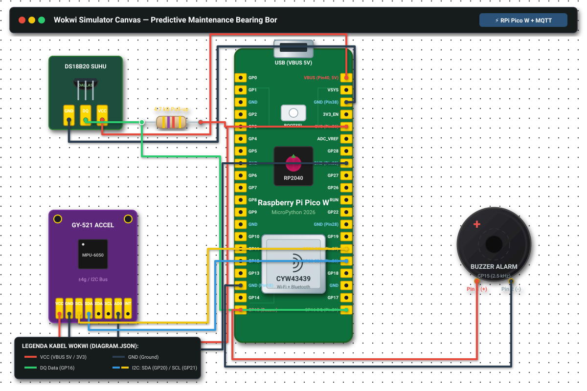
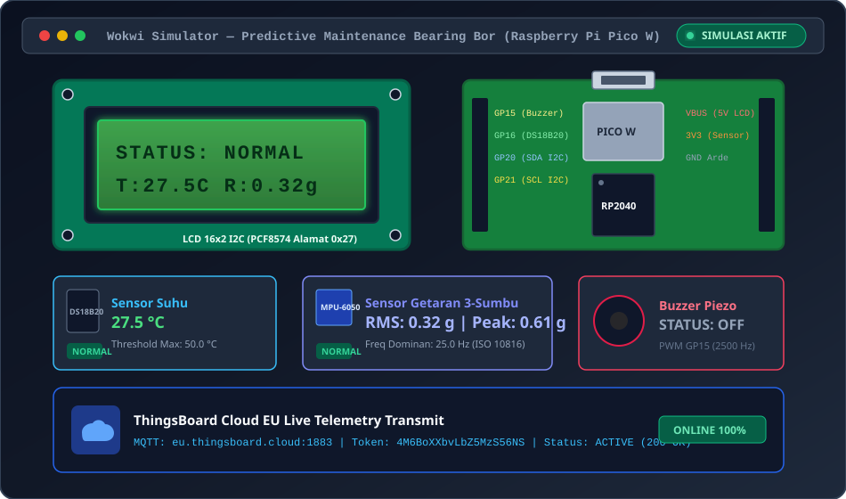
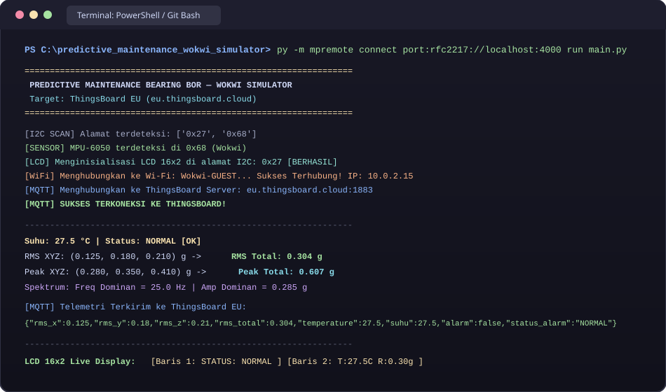

# PREDICTIVE MAINTENANCE BEARING BOR (WOKWI & THINGSBOARD)

Proyek sistem pemantauan kesehatan bantalan bor (*drill bearing*) secara real-time berbasis IoT dengan simulator **Wokwi** (Raspberry Pi Pico W) dan implementasi fisik **Raspberry Pi 4 Model B** yang terintegrasi langsung ke **ThingsBoard Cloud EU** (`eu.thingsboard.cloud`).

---

## 🔌 1. Skema Wiring & Penjelasan Pinout



### A. Tabel Wiring Simulasi: Raspberry Pi Pico W (Wokwi)

| Komponen | Pin Modul / Sensor | Warna Kabel | Pin Fisik Pico | Pin GPIO Pico | Fungsi & Penjelasan Rangkaian |
| :--- | :--- | :--- | :--- | :--- | :--- |
| **DS18B20**<br>*(Sensor Suhu)* | **VCC** (Kabel Merah) | **Merah** | **Pin 36** | **3V3 (OUT)** | Tegangan 3.3V aman untuk level logika RP2040 (3.0V–5.5V). |
| | **GND** (Kabel Hitam) | **Hitam** | **Pin 38** | **GND** | Jalur arde bersama (*Common Ground*). |
| | **DQ** (Kabel Hijau/Kuning) | **Hijau** | **Pin 21** | **GP16** | Jalur data bus OneWire. |
| **Resistor 4.7 kΩ**<br>*(Pull-up OneWire)* | Pin 1 | Hijau | Pin 21 | GP16 | Terhubung ke pin data `DQ` DS18B20. |
| | Pin 2 | Merah / Oranye | Pin 36 | 3V3 (OUT) | Menarik level tegangan default ke 3.3V saat jalur idle. |
| **MPU-6050** *(Wokwi)*<br>*(Emulasi ADXL345)* | **VCC** | **Merah** | **Pin 36** | **3V3 (OUT)** | Catu daya logika I2C 3.3V. |
| | **GND & AD0** | **Hitam** | **Pin 28** | **GND** | Arde & menentukan alamat I2C default `0x68`. |
| | **SCL** | **Kuning / Emas** | **Pin 27** | **GP21** | Jalur Clock I2C0. |
| | **SDA** | **Biru** | **Pin 26** | **GP20** | Jalur Data I2C0. |
| **Buzzer Alarm**<br>*(Piezo)* | **Pin 2 / Positif (+)** | **Merah** | **Pin 20** | **GP15** | Kontrol sinyal PWM alarm frekuensi 2500 Hz (Pin 2 Wokwi). |
| | **Pin 1 / Negatif (-)** | **Hitam** | **Pin 18** | **GND** | Jalur arde buzzer (Pin 1 Wokwi). |
| **LCD 16x2 I2C**<br>*(PCF8574 Backpack)* | **VCC** | **Merah** | **Pin 40** | **VBUS (5V)** | Daya 5V modul LCD & lampu latar backlight. |
| | **GND** | **Hitam** | **Pin 23** | **GND** | Jalur arde bersama (Pin 23 Pico GND.5). |
| | **SDA** | **Biru** | **Pin 26** | **GP20** | Jalur Data I2C0 SDA (Alamat default `0x27`). |
| | **SCL** | **Kuning / Emas** | **Pin 27** | **GP21** | Jalur Clock I2C0 SCL. |

> ⚠️ **Catatan Penting Polaritas Buzzer Wokwi:**
> Pada komponen `wokwi-buzzer`, **Pin 1 adalah Negatif (GND)** dan **Pin 2 adalah Positif (Signal/PWM)**. Jika dipasang terbalik, simulator tidak akan menghasilkan audio buzzer.

---

### B. Tabel Wiring Perangkat Keras Fisik: Raspberry Pi 4 Model B

| Modul / Sensor | Pin Modul | Pin Fisik RPi 4 | Nama Pin BCM | Penjelasan Khusus RPi 4 |
| :--- | :--- | :--- | :--- | :--- |
| **ADXL345 (Getaran)** | **VCC** | **Pin 1** | `3V3 Power` | Catu daya logika 3.3V. |
| | **GND** | **Pin 9** | `Ground` | Jalur arde bersama. |
| | **SDA** | **Pin 3** | `GPIO 2 (I2C1 SDA)` | Jalur data serial I2C bus 1. |
| | **SCL** | **Pin 5** | `GPIO 3 (I2C1 SCL)` | Jalur clock serial I2C bus 1. |
| | **CS** | **Pin 17** | `3V3 Power` | Hubungkan ke 3.3V untuk mengaktifkan mode I2C. |
| | **SDO** | **Pin 25** | `Ground` | Hubungkan ke GND untuk memilih alamat I2C `0x53`. |
| **DS18B20 (Suhu)** | **VCC** (Merah) | **Pin 1** / **Pin 17** | `3V3 Power` | Gunakan **3.3V** agar pin GPIO RPi tidak rusak oleh overvoltage. |
| | **GND** (Hitam) | **Pin 6** | `Ground` | Arde bersama. |
| | **DQ** (Kuning) | **Pin 7** | `GPIO 4 (GPCLK0)` | Jalur data kernel Linux 1-Wire (`w1-gpio`). |
| | **Pull-Up 4.7 kΩ** | Antara DQ & 3.3V | Resistor 4.7 kΩ | Jumper dari **Pin 7 (DQ)** ke **Pin 1 (3V3)**. |
| **Buzzer Aktif 5V** | **Positif (+)** | **Pin 12** | `GPIO 18 (PWM0)` | Kontrol trigger alarm via transistor/driver buzzer. |
| | **Negatif (-)** | **Pin 14** | `Ground` | Arde buzzer. |
| **LCD 16x2 I2C**<br>*(PCF8574 Backpack)* | **VCC** | **Pin 2** / **Pin 4** | `5V Power` | Catu daya 5V untuk modul LCD. |
| | **GND** | **Pin 20** / **Pin 39** | `Ground` | Arde bersama. |
| | **SDA** | **Pin 3** | `GPIO 2 (I2C1 SDA)` | Jalur data I2C bus 1 (Alamat `0x27`). |
| | **SCL** | **Pin 5** | `GPIO 3 (I2C1 SCL)` | Jalur clock I2C bus 1. |

---

### C. Logika Tampilan Status Layar LCD 16x2

Layar LCD 16x2 secara otomatis menampilkan kondisi diagnosa real-time sesuai instruksi sistem:

* **Kondisi 1: Getaran Melebihi Threshold Saja (`RMS >= 2.50 g` / `Peak >= 4.50 g`):**
  ```text
  Baris 1: ALAT BERGETAR,
  Baris 2: RUSAK!
  ```
* **Kondisi 2: Suhu Melebihi Threshold Saja (`Suhu >= 50.0 °C`):**
  ```text
  Baris 1: ALAT PANAS!
  Baris 2: RUSAK
  ```
* **Kondisi 3: Keduanya Melebihi Threshold (Getaran & Suhu):**
  ```text
  Baris 1: ALAT BERGETAR &
  Baris 2: PANAS! RUSAK!!!
  ```
* **Kondisi Normal (Aman):**
  ```text
  Baris 1: STATUS: NORMAL
  Baris 2: T:27.5C R:0.30g
  ```

---

## 🚀 2. Panduan Menjalankan Simulasi Wokwi

Tersedia dua opsi untuk menjalankan simulasi:

### Opsi A: Melalui Browser di Wokwi.com (Paling Direkomendasikan & Instan)
Di antarmuka web, MicroPython langsung mengeksekusi skrip otomatis tanpa memerlukan instalasi software lokal:
1. Buka [https://wokwi.com](https://wokwi.com) lalu pilih board **Raspberry Pi Pico W**.
2. Salin seluruh isi berkas [diagram.json](diagram.json) ke tab **`diagram.json`** di Wokwi.
3. Salin seluruh isi berkas [main.py](main.py) ke tab **`main.py`** di Wokwi.
4. Klik tombol **Play (Start Simulation)** di kanan atas.
5. Pantau **Serial Monitor**:
   - Pico W tersambung ke `Wokwi-GUEST`.
   - Mengirim telemetri berkala ke `eu.thingsboard.cloud`.
   - Status perangkat di ThingsBoard otomatis berubah menjadi **ACTIVE**.

### Opsi B: Panduan Lengkap Menjalankan di VS Code (Visual Studio Code)

Untuk menjalankan proyek ini secara lokal di VS Code dengan ekstensi simulator Wokwi, ikuti tahapan berikut secara runtut:

#### 1. Checklist Environment yang Wajib Disiapkan di PC & VS Code
Pastikan komponen lingkungan pengembangan berikut siap:
* **Python 3.x (Interpreter PC):**
  * *Status:* ✅ **Sudah Terpasang di PC Anda** (Versi: `Python 3.15.2` di `C:\Users\minipingu\AppData\Local\Python\pythoncore-3.15-64\python.exe`).
* **Tool `mpremote` (Jembatan MicroPython Simulator):**
  * *Status:* ✅ **Sudah Terpasang di PC Anda** (Versi `1.29.0` dan folder `Scripts` sudah dimasukkan ke PATH).
* **Ekstensi VS Code yang Wajib Diinstal:**
  1. **Wokwi Simulator** (ID: `wokwi.wokwi-vscode`) — Ekstensi utama untuk mensimulasikan Raspberry Pi Pico W, MPU-6050, DS18B20, Buzzer, dan LCD 16x2.
  2. **Python** (ID: `ms-python.python` oleh Microsoft) — Untuk syntax highlighting, linter, dan eksekusi skrip di terminal VS Code.
* **Aktivasi Lisensi Wokwi Gratis:**
  * Buka VS Code $\rightarrow$ tekan `F1` (atau `Ctrl+Shift+P`) $\rightarrow$ ketik `Wokwi: Request a new License` $\rightarrow$ browser akan membuka halaman web Wokwi untuk otorisasi instan (100% gratis).

---

#### 2. Langkah Menjalankan Simulasi di VS Code dari Awal
1. **Buka Folder Proyek di VS Code:**
   Buka menu `File` $\rightarrow$ `Open Folder...` $\rightarrow$ pilih folder `predictive_maintenance_wokwi_simulator`.
2. **Mulai Simulator Wokwi:**
   * Buka berkas [diagram.json](diagram.json).
   * Klik tombol hijau **Play (Start Simulation)** di kanan atas kanvas diagram, atau tekan `F1` $\rightarrow$ pilih **`Wokwi: Start Simulator`**.
   * Simulator akan memuat kanvas dengan Pico W, LCD 16x2, DS18B20, MPU-6050, dan Buzzer.
3. **PENTING: Jaga Tab Simulator Tetap Aktif / Terlihat di Layar:**
   > ⚠️ **Peringatan Hemat Daya VS Code:** VS Code secara otomatis mem-pause tab simulator yang diminimize atau tertutup ke background tab lain. Disarankan melakukan **Split Editor Right** (klik kanan tab `diagram.json` $\rightarrow$ `Split Right`) agar simulator tetap terlihat di kanan layar saat terminal aktif.
4. **Eksekusi `main.py` Menggunakan Terminal VS Code:**
   Buka terminal di VS Code (`Ctrl+\`` atau menu `Terminal` $\rightarrow$ `New Terminal`), lalu jalankan salah satu perintah berikut:

   > 💡 **Penting Memilih Tab Terminal:** Pastikan menjalankan perintah di bawah pada tab terminal sistem (**PowerShell** atau **Git Bash**), **BUKAN** di dalam tab **`Wokwi Terminal`** (yang memiliki prompt `>>>` MicroPython REPL internal).

   * **Cara 1: Salin Permanen ke Flash Simulator (Sangat Direkomendasikan):**
     Menyalin [main.py](main.py) langsung ke dalam virtual flash Pico W agar program berjalan otomatis setiap kali tombol Play ditekan di masa mendatang:
     ```bash
     py -m mpremote connect port:rfc2217://localhost:4000 fs cp main.py :main.py
     ```
     *(Atau cukup `mpremote connect port:rfc2217://localhost:4000 fs cp main.py :main.py` jika membuka terminal baru).*
     
     Setelah proses copy selesai, klik tombol **Restart Simulation** (panah melingkar hijau) pada kanvas Wokwi atau tekan `Ctrl+D` di `Wokwi Terminal`. Program akan langsung berjalan otomatis!

   * **Cara 2: Eksekusi Langsung Sekali Jalan:**
     ```bash
     py -m mpremote connect port:rfc2217://localhost:4000 run main.py
     ```

5. **Pantau Hasil pada Layar LCD & Terminal:**
   * Layar LCD 16x2 pada simulator akan langsung menyala menampilkan: `STATUS: NORMAL` dan pembacaan `T:..C R:..g`.
   * Terminal menampilkan log Wi-Fi terhubung dan telemetri berhasil terkirim ke `eu.thingsboard.cloud`.

   #### 📸 Screenshot Hasil Pembacaan di Simulator (Kanvas Wokwi):
   

   #### 💻 Screenshot Hasil Pembacaan di Serial Terminal:
   

---

#### 3. Troubleshooting Masalah Umum di VS Code
* **Error `bash: mpremote: command not found`:**
  * *Penyebab:* Terminal Git Bash dibuka sebelum PATH environment Windows diperbarui.
  * *Solusi:* Gunakan launcher Python: `py -m mpremote ...` (atau buka tab terminal baru di VS Code).
* **Error `SyntaxError: invalid syntax` saat Mengetik Perintah di Terminal:**
  * *Penyebab:* Perintah shell `py -m mpremote ...` diketikkan di dalam tab **`Wokwi Terminal`** (prompt `>>>` REPL MicroPython), bukan di terminal PowerShell atau Git Bash komputer.
  * *Solusi:* Klik ikon panah dropdown / tombol `+` di panel terminal VS Code $\rightarrow$ pilih terminal **PowerShell** atau **Git Bash** untuk menjalankan perintah sistem. Jika file sudah pernah disalin, cukup tekan **`Ctrl + D`** di tab `Wokwi Terminal` untuk soft-reboot.
* **Error `AttributeError: 'str' object has no attribute 'ljust'`:**
  * *Penyebab:* MicroPython RP2040 memangkas fungsi string `.ljust()` untuk menghemat memori mikrokontroler.
  * *Solusi:* Sudah diperbaiki di [main.py](main.py) menggunakan formulasi padding string standar `(str(line)[:16] + " " * 16)[:16]`.
* **Error `failed to access rfc2217://localhost:4000 (it may be in use by another program)` / `Connection refused`:**
  * *Penyebab:* Simulasi Wokwi belum di-Play atau konfigurasi `wokwi.toml` belum dimuat ulang oleh simulator.
  * *Solusi:*
    1. Buka tab [diagram.json](diagram.json).
    2. Jika sedang jalan, tekan **Stop** (kotak merah) lalu tekan **Play** (segitiga hijau).
    3. Biarkan tab simulator tetap terlihat di layar (jangan di-minimize).
    4. Jalankan kembali perintah: `py -m mpremote connect port:rfc2217://localhost:4000 fs cp main.py :main.py`.
* **Error `ImportError: no module named 'network'` & Layar LCD Kosong / Tidak Tampil Apa-apa:**
  * *Penyebab:* Simulator memuat firmware Pico RP2040 standar (non-Wi-Fi), sehingga program langsung *crash* di baris awal `import network` sebelum sempat menginisialisasi layar LCD.
  * *Solusi:*
    1. Pastikan file [firmware.uf2](firmware.uf2) adalah build resmi **Raspberry Pi Pico W** (sudah diperbarui otomatis di repository ini).
    2. Di kanvas Wokwi, klik tombol **Stop** (kotak merah) lalu klik **Play** (segitiga hijau) agar Wokwi memuat ulang `firmware.uf2` yang baru dari disk.
    3. Jalankan `py -m mpremote connect port:rfc2217://localhost:4000 fs cp main.py :main.py`.
    4. Klik tombol **Restart Simulation** (panah melingkar hijau). Layar LCD akan langsung menyala!
* **Error `TransportError: could not enter raw repl`:**
  * *Penyebab:* Tab simulator tertutup atau berada di background sehingga ter-pause otomatis oleh fitur hemat daya VS Code.
  * *Solusi:* Klik kembali tab [diagram.json](diagram.json) (Split Right) agar aktif di layar, lalu jalankan kembali perintah `mpremote`.

### 🧪 Cara Menguji Alarm & Interaktivitas di Wokwi:
* **Uji Alarm Suhu:** Klik komponen **DS18B20** pada kanvas $\rightarrow$ geser slider suhu di atas **50.0 °C**. Buzzer langsung berbunyi dan alarm terpicu.
* **Uji Alarm Getaran:** Klik komponen **MPU-6050** $\rightarrow$ geser nilai percepatan sumbu di atas **2.50 g**.
* **Kondisi Normal:** Turunkan suhu di bawah 50 °C dan getaran di bawah 2.5 g $\rightarrow$ buzzer otomatis mati dan status kembali `NORMAL`.

---

## 🍓 3. Panduan Detail Menjalankan di Raspberry Pi 4 (Hardware Fisik)

Sistem pemantauan ini dirancang siap jalan di lingkungan industri menggunakan komputer papan tunggal **Raspberry Pi 4 Model B** dengan skrip [rpi4_main.py](rpi4_main.py).

### Langkah 1: Mengaktifkan Antarmuka I2C & 1-Wire di Raspberry Pi OS
Buka terminal Raspberry Pi 4:
```bash
sudo raspi-config
```
1. Masuk ke **Interface Options** $\rightarrow$ **I2C** $\rightarrow$ Pilih **Yes** (Enable).
2. Masuk ke **Interface Options** $\rightarrow$ **1-Wire** $\rightarrow$ Pilih **Yes** (Enable).
3. Pilih **Finish** dan reboot sistem:
   ```bash
   sudo reboot
   ```
*(Alternatif tanpa menu: tambahkan baris `dtparam=i2c_arm=on` dan `dtoverlay=w1-gpio,gpiopin=4` pada file `/boot/firmware/config.txt` atau `/boot/config.txt`).*

---

### Langkah 2: Menguji Deteksi Sensor Fisik di Terminal Linux
Setelah reboot, verifikasi bahwa sensor terdeteksi oleh kernel:
1. **Periksa Sensor Getaran ADXL345 (I2C):**
   ```bash
   sudo apt install -y i2c-tools
   i2cdetect -y 1
   ```
   *Hasil:* Alamat **`53`** (ADXL345) atau **`68`** (MPU-6050) akan muncul di tabel matriks I2C.
2. **Periksa Sensor Suhu DS18B20 (1-Wire):**
   ```bash
   ls /sys/bus/w1/devices/
   ```
   *Hasil:* Folder berawalan **`28-xxxxxxxxxxxx`** akan tampil. Cek pembacaan suhu langsung:
   ```bash
   cat /sys/bus/w1/devices/28-*/w1_slave
   ```
   *Hasil:* Baris kedua menampilkan nilai `t=28125` (artinya suhu $28.125 \text{ }^\circ\text{C}$).

---

### Langkah 3: Menginstal Dependensi Python 3
Jalankan perintah instalasi paket:
```bash
sudo apt update
sudo apt install -y python3-pip python3-smbus python3-gpiozero python3-numpy
pip3 install paho-mqtt smbus2
```

---

### Langkah 4: Menjalankan Program Monitoring
Jalankan program utama Raspberry Pi 4:
```bash
python3 rpi4_main.py
```
Log serial akan menampilkan metrik real-time:
```text
=================================================================
 PREDICTIVE MAINTENANCE BEARING BOR - RASPBERRY PI 4
 Target : ThingsBoard EU (eu.thingsboard.cloud)
=================================================================
[SENSOR] ADXL345 fisik aktif di I2C address 0x53
[MQTT] Menghubungkan ke ThingsBoard Server: eu.thingsboard.cloud:1883...
[MQTT] SUKSES TERKONEKSI KE THINGSBOARD!

-----------------------------------------------------------------
Suhu: 32.4 °C | Status: NORMAL [OK]
RMS XYZ: (0.124, 0.089, 0.985) g -> RMS Total: 0.997 g
Peak XYZ: (0.245, 0.150, 1.120) g -> Peak Total: 1.156 g
Spektrum: Freq Dominan = 14.5 Hz | Amp Dominan = 0.082 g
[MQTT] Telemetri Terkirim ke ThingsBoard EU:
        {"rms_x": 0.124, "rms_y": 0.089, "rms_z": 0.985, "rms_total": 0.997, ...}
```

---

### Langkah 5: Menjalankan Otomatis Saat Booting (Systemd Service 24/7)
Agar skrip berjalan otomatis saat mesin pabrik dinyalakan tanpa perlu login manual:
1. Buat berkas service:
   ```bash
   sudo nano /etc/systemd/system/bearing_monitor.service
   ```
2. Tempelkan konfigurasi berikut:
   ```ini
   [Unit]
   Description=Predictive Maintenance Bearing Bor Service
   After=network-online.target
   Wants=network-online.target

   [Service]
   Type=simple
   User=pi
   WorkingDirectory=/home/pi/predictive_maintenance_wokwi_simulator
   ExecStart=/usr/bin/python3 /home/pi/predictive_maintenance_wokwi_simulator/rpi4_main.py
   Restart=always
   RestartSec=5

   [Install]
   WantedBy=multi-user.target
   ```
3. Aktifkan dan jalankan service:
   ```bash
   sudo systemctl daemon-reload
   sudo systemctl enable bearing_monitor.service
   sudo systemctl start bearing_monitor.service
   ```
4. Periksa status layanan kapan saja:
   ```bash
   sudo systemctl status bearing_monitor.service
   ```

---

## 📁 4. Struktur Berkas

```
predictive_maintenance_wokwi_simulator/
├── diagram.json          # File rangkaian Wokwi Simulator lengkap (Raspberry Pi Pico W)
├── wokwi.toml            # Konfigurasi simulasi Wokwi
├── firmware.uf2          # MicroPython binary untuk Pico W
├── main.py               # Program utama Pico W standalone (Driver Sensor, FFT, RMS, Alarm, MQTT & HTTP)
├── rpi4_main.py          # Program utama fisik Raspberry Pi 4 (Linux, Python 3, Paho MQTT)
├── WIRING_DIAGRAM.svg    # Skema diagram canvas Wokwi resolusi tinggi
├── WIRING_PREVIEW.html   # Pratinjau wiring interaktif di browser
├── WIRING_DIAGRAM.md     # Panduan detail wiring & pinout
└── README.md             # Panduan komprehensif proyek
```

---

## ⚠️ 5. Ambang Batas (Thresholds) & Simulasi Monitoring Mesin Bor Duduk (ISO 10816)

Sistem ini dirancang khusus untuk memantau kesehatan bantalan poros utama (*spindle bearing*) pada **Mesin Bor Duduk (*Bench Drill Machine*)** berdasarkan standar getaran internasional **ISO 10816-3 (Class 1: Mesin Perkakas Berputar)**.

### A. Parameter Operasional Spindle Bor Duduk (Contoh: 1500 RPM)
Pada mesin bor duduk transmisi sabuk puli (*belt pulley*), kecepatan spindle standar yang paling umum adalah **1500 RPM** (motor induksi 4-kutub 50 Hz). Parameter frekuensi getaran mekanisnya:
* **Frekuensi Putaran Poros Utama ($1\times$ RPM / *Shaft Speed*):**
  $$f_{\text{shaft}} = \frac{1500\text{ RPM}}{60} = \mathbf{25.0\text{ Hz}}$$
  *(Merupakan frekuensi puncak spektrum FFT saat terjadi unbalance spindle bor)*.
* **Harmonik ke-2 ($2\times$ Shaft / *Misalignment Pulley*):**
  $$f_{\text{harmonic}} = 2 \times 25.0\text{ Hz} = \mathbf{50.0\text{ Hz}}$$
  *(Menandakan ketidaksejajaran puli sabuk bor)*.
* **Frekuensi Cacat Bantalan (*Outer Race Defect* BPFO Bearing 6205):**
  $$f_{\text{BPFO}} \approx 3.1 \times f_{\text{shaft}} = \mathbf{77.5\text{ Hz}}$$

> 💡 **Kustomisasi RPM Mesin Bor:**
> Untuk mengganti RPM sesuai rasio puli mesin Anda (misal **900 RPM**, **1800 RPM**, atau **2400 RPM**), cukup ubah variabel `RPM_SPINDLE = 1500` di baris ke-20 pada [main.py](main.py). Semua frekuensi harmonik dan laju FFT akan otomatis terkalkulasi ulang.

---

### B. Tabel Ambang Batas (Thresholds) Standar ISO 10816-3

| Parameter Monitoring | Zona Normal (Aman) | Zona Bahaya / Alarm (Rusak) | Indikasi Fisik Kegagalan Bearing Bor |
| :--- | :--- | :--- | :--- |
| **Suhu Bearing (DS18B20)** | $25.0^\circ\text{C} - 45.0^\circ\text{C}$ | **$\ge \mathbf{50.0^\circ\text{C}}$** | Pelumas (*grease*) mencair/rusak, gesekan bola bantalan berlebih, risiko macet (*spindle seizure*). |
| **RMS Total Getaran** | $< 1.80\text{ g}$ ($< 17.6\text{ m/s}^2$) | **$\ge \mathbf{2.50\text{ g}}$ ($\mathbf{24.52\text{ m/s}^2}$)** | Cacat lintasan dalam/luar (*flaking*), kelonggaran dudukan bantalan (*bearing looseness*). |
| **Peak Total Getaran** | $< 3.50\text{ g}$ ($< 34.3\text{ m/s}^2$) | **$\ge \mathbf{4.50\text{ g}}$ ($\mathbf{44.13\text{ m/s}^2}$)** | Pukulan kejut impulsif (*chipping/spalling* retak pada bola bearing). |

---

### C. Matriks 4 Skenario Simulasi Interaktif di Wokwi

Anda dapat menguji respon sistem (LCD, Buzzer, dan ThingsBoard) dengan menggeser slider komponen pada kanvas Wokwi:

| Skenario Pengujian | Slider DS18B20 | Slider MPU-6050 | Tampilan Layar LCD 16x2 | Buzzer GP15 | Status ThingsBoard EU |
| :--- | :--- | :--- | :--- | :--- | :--- |
| **1. Kondisi Normal**<br>*(Operasional Aman)* | **$35.0^\circ\text{C}$**<br>*(Normal)* | **$(0, 0, 0)\text{ g}$**<br>*(RMS ~ $0.25\text{ g}$)* | Baris 1: `STATUS: NORMAL`<br>Baris 2: `T:35.0C R:0.25g` | **MATI (OFF)** | `status_alarm: "NORMAL"`<br>`alarm: false` |
| **2. Kerusakan Getaran**<br>*(Spindle Unbalance)* | **$35.0^\circ\text{C}$**<br>*(Normal)* | **$X \ge 2.0\text{ g}$**<br>*(RMS $\ge 2.85\text{ g}$)* | Baris 1: `ALAT BERGETAR,`<br>Baris 2: `RUSAK!` | **BUNYI**<br>*(PWM 2500 Hz)* | `status_alarm: "ALARM"`<br>`alarm: true (HIGH_RMS)` |
| **3. Overheat Suhu**<br>*(Pelumas Kering)* | **$65.0^\circ\text{C}$**<br>*(Panas)* | **$(0, 0, 0)\text{ g}$**<br>*(RMS ~ $0.25\text{ g}$)* | Baris 1: `ALAT PANAS!`<br>Baris 2: `RUSAK` | **BUNYI**<br>*(PWM 2500 Hz)* | `status_alarm: "ALARM"`<br>`alarm: true (OVERHEAT)` |
| **4. Kritis Keduanya**<br>*(Getaran & Panas)* | **$65.0^\circ\text{C}$**<br>*(Panas)* | **$X \ge 2.0\text{ g}$**<br>*(RMS $\ge 2.85\text{ g}$)* | Baris 1: `ALAT BERGETAR &`<br>Baris 2: `PANAS! RUSAK!!!` | **BUNYI**<br>*(PWM 2500 Hz)* | `status_alarm: "ALARM"`<br>`alarm: true (DUAL ALARM)` |

---

## 📡 6. Konfigurasi ThingsBoard EU & Format Telemetri

* **Server:** `eu.thingsboard.cloud` (Port MQTT: `1883`, Port HTTP: `80` / `443`)
* **Access Token:** `4M6BoXXbvLbZ5MzS56NS`
* **Topic MQTT:** `v1/devices/me/telemetry`

**Format JSON Telemetri yang Dikirim:**
```json
{
  "rms_x": 0.125,
  "rms_y": 0.180,
  "rms_z": 0.210,
  "rms_total": 0.304,
  "frekuensi_dominan_total": 25.0,
  "peak_x": 0.280,
  "peak_y": 0.350,
  "peak_z": 0.410,
  "peak_total": 0.607,
  "amplitudo_dominan_total": 0.285,
  "temperature": 27.5,
  "suhu": 27.5,
  "temp": 27.5,
  "alarm": false,
  "status_alarm": "NORMAL"
}
```

> [!NOTE]
> **Mengapa Parameter Suhu Berada di Halaman 2 di ThingsBoard?**
> Tabel **Latest telemetry** pada dashboard ThingsBoard secara default terurut secara alfabetis (**Key A $\rightarrow$ Z**) dan menampilkan **10 baris per halaman**.
> Parameter suhu (`temperature` / `suhu`) diawali huruf **S** dan **T**, sehingga posisinya berada di bawah parameter huruf **A**, **F**, dan **P**.
> * **Cara Melihat:** Klik tombol panah **`>`** (Next Page) di sudut kanan bawah tabel ThingsBoard, atau gunakan kotak pencarian (ikon 🔍) di kanan atas tabel dengan mengetik `suhu` atau `temp`.
